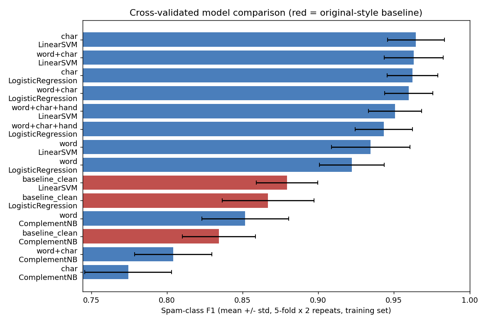
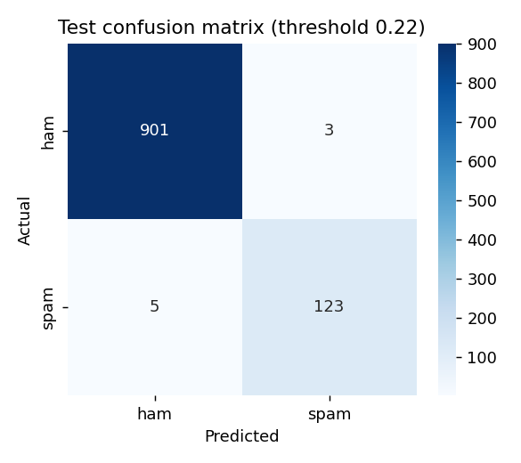

# SPAM / HAM SMS Classification (improved)

Classifies SMS messages as **SPAM**, **HAM** or **REVIEW** (uncertain → send to a human / rule check).
This is a rebuilt version of the original project that fixes its evaluation weaknesses and improves accuracy.

## Results (held-out test set, evaluated once)

De-duplicated data: 5,158 messages (12.4% spam). Train 4,126 / Test 1,032 (128 spam). The split is **grouped**: templated
near-duplicate messages always stay on the same side. Spam-class metrics:

| Model | Precision | Recall | F1 |
|---|---|---|---|
| Original-style baseline (cleaned text, TF-IDF 3000 feats, Linear SVM) | 0.909 | 0.781 | 0.840 |
| **Improved**, default threshold 0.5 | 0.984 | 0.938 | 0.960 |
| **Improved**, tuned threshold 0.217 | 0.976 | 0.961 | **0.969** |

* Bootstrap 95% CI (tuned): precision 0.95-1.00, recall 0.93-0.99, F1 0.94-0.99 (only 128 spam messages in test).
* Cross-validated F1 (training set, grouped folds): improved **0.965** vs. original-style **0.879**.
* Review band: 5.4% of test messages go to REVIEW; accuracy on the remaining auto-decided messages is **99.5%**.
* Test outcomes: 3 false positives, 5 false negatives, 53 needing review, out of 1,032. Average precision 0.983.

**Robustness to obfuscated spam** (every test spam rewritten with leetspeak / dotted / split words, e.g. `fr33`, `w.i.n`, `pr ize`):

| Training | Recall on clean spam | Recall on obfuscated spam |
|---|---|---|
| Plain | 0.969 | 0.938 |
| **+ obfuscation augmentation (train only)** | 0.961 | **0.984** |

> Numbers changed from earlier versions on purpose: the split is now grouped by near-duplicate template, text is
> HTML-unescaped, and the threshold/calibration are computed on augmented, group-aware out-of-fold predictions.
> A stricter protocol gives slightly lower but more trustworthy scores.

## What was improved

| Problem in original | Fix |
|---|---|
| Best model chosen on the **test set** | Repeated stratified **grouped cross-validation on train only**; test used once |
| Duplicates / near-duplicate templates could leak into test | Exact **de-duplication** + **near-duplicate grouping** (`StratifiedGroupKFold`) |
| `&lt;#&gt;` / `&amp;` HTML leftovers in the data | `html.unescape` normalisation |
| Cleaning removed digits, punctuation, case, `£`, `!` | Uses **raw text** + **character n-grams (2-5)** |
| Filters can be dodged with `fr33` / `w.i.n` | **Obfuscation augmentation** of training spam + measured robustness test |
| README says precision matters, but F1 was the selector | **Calibrated probabilities + threshold tuned to a target spam precision (0.98)** |
| Hard yes/no on borderline messages | Explicit **REVIEW band** (most uncertain ~5%) |
| Black-box predictions | Per-message **explanations** (word occlusion, log-odds) in the app and API |
| No uncertainty on results | **Bootstrap confidence intervals** |
| Hard-coded `D:\\` path; scripts missing; 71 MB NLTK data | Relative paths, sklearn `Pipeline`s, no NLTK, tests, **CI**, Streamlit demo, **FastAPI** service |

Negative results worth reporting (all measured with grouped CV on the full data):
* Hand-crafted features (length, digit/upper-case ratios, URL/currency flags) **did not help** (F1 0.951 vs 0.965).
* **Replacing digits with a placeholder hurt** (F1 0.954 vs 0.968) - exact digits/short codes are spam signals.
* A **soft-voting ensemble** (char-SVM + word+char LR) gave no gain (F1 0.967 vs 0.968).
* Near-duplicate grouping barely moved the score (169 messages merged) - a good sign that leakage was small.

The hand-crafted features remain in `src/features.py` for experimentation.

## Project structure

```
data/SMSSpamCollection.tsv     raw dataset (label <TAB> message)
src/
  data.py                      loading, HTML-unescape, de-duplication, near-duplicate groups
  preprocessing.py             cleaning (used only by the baseline model)
  features.py                  vectorizers, hand-crafted features, pipeline builder
  augment.py                   obfuscation augmentation (train only)
  explain.py                   word-level explanations
  inference.py                 load model, SPAM / HAM / REVIEW decision
train.py                       CV selection -> tuning -> calibration -> threshold -> test -> plots
predict.py                     command-line predictions
app.py                         Streamlit demo (with explanations)
api.py                         FastAPI service (/classify, /classify/batch, /health)
.github/workflows/ci.yml       CI: train + pytest on every push
tests/test_pipeline.py         unit + end-to-end + API tests
MODEL_CARD.md                  intended use, metrics, limitations
Makefile / pyproject.toml      shortcuts (make train/test/lint) and lint config
notebooks/                     executed report notebook (.ipynb)
models/                        created by train.py: model.joblib + config.json (not committed)
outputs/                       cv_results.csv, test_metrics.json, error_analysis.csv, plots
```

## How to run

# SPAM / HAM SMS Classification (improved)

Classifies SMS messages as **SPAM**, **HAM** or **REVIEW** (uncertain → send to a human / rule check).
This is a rebuilt version of the original project that fixes its evaluation weaknesses and improves accuracy.

## Results (held-out test set, evaluated once)

De-duplicated data: 5,158 messages (12.4% spam). Train 4,126 / Test 1,032 (128 spam). The split is **grouped**: templated
near-duplicate messages always stay on the same side. Spam-class metrics:

| Model | Precision | Recall | F1 |
|---|---|---|---|
| Original-style baseline (cleaned text, TF-IDF 3000 feats, Linear SVM) | 0.909 | 0.781 | 0.840 |
| **Improved**, default threshold 0.5 | 0.984 | 0.938 | 0.960 |
| **Improved**, tuned threshold 0.217 | 0.976 | 0.961 | **0.969** |

* Bootstrap 95% CI (tuned): precision 0.95-1.00, recall 0.93-0.99, F1 0.94-0.99 (only 128 spam messages in test).
* Cross-validated F1 (training set, grouped folds): improved **0.965** vs. original-style **0.879**.
* Review band: 5.4% of test messages go to REVIEW; accuracy on the remaining auto-decided messages is **99.5%**.
* Test outcomes: 3 false positives, 5 false negatives, 53 needing review, out of 1,032. Average precision 0.983.

**Robustness to obfuscated spam** (every test spam rewritten with leetspeak / dotted / split words, e.g. `fr33`, `w.i.n`, `pr ize`):

| Training | Recall on clean spam | Recall on obfuscated spam |
|---|---|---|
| Plain | 0.969 | 0.938 |
| **+ obfuscation augmentation (train only)** | 0.961 | **0.984** |

> Numbers changed from earlier versions on purpose: the split is now grouped by near-duplicate template, text is
> HTML-unescaped, and the threshold/calibration are computed on augmented, group-aware out-of-fold predictions.
> A stricter protocol gives slightly lower but more trustworthy scores.

## What was improved

| Problem in original | Fix |
|---|---|
| Best model chosen on the **test set** | Repeated stratified **grouped cross-validation on train only**; test used once |
| Duplicates / near-duplicate templates could leak into test | Exact **de-duplication** + **near-duplicate grouping** (`StratifiedGroupKFold`) |
| `&lt;#&gt;` / `&amp;` HTML leftovers in the data | `html.unescape` normalisation |
| Cleaning removed digits, punctuation, case, `£`, `!` | Uses **raw text** + **character n-grams (2-5)** |
| Filters can be dodged with `fr33` / `w.i.n` | **Obfuscation augmentation** of training spam + measured robustness test |
| README says precision matters, but F1 was the selector | **Calibrated probabilities + threshold tuned to a target spam precision (0.98)** |
| Hard yes/no on borderline messages | Explicit **REVIEW band** (most uncertain ~5%) |
| Black-box predictions | Per-message **explanations** (word occlusion, log-odds) in the app and API |
| No uncertainty on results | **Bootstrap confidence intervals** |
| Hard-coded `D:\\` path; scripts missing; 71 MB NLTK data | Relative paths, sklearn `Pipeline`s, no NLTK, tests, **CI**, Streamlit demo, **FastAPI** service |

Negative results worth reporting (all measured with grouped CV on the full data):
* Hand-crafted features (length, digit/upper-case ratios, URL/currency flags) **did not help** (F1 0.951 vs 0.965).
* **Replacing digits with a placeholder hurt** (F1 0.954 vs 0.968) - exact digits/short codes are spam signals.
* A **soft-voting ensemble** (char-SVM + word+char LR) gave no gain (F1 0.967 vs 0.968).
* Near-duplicate grouping barely moved the score (169 messages merged) - a good sign that leakage was small.

The hand-crafted features remain in `src/features.py` for experimentation.

## Project structure

```
data/SMSSpamCollection.tsv     raw dataset (label <TAB> message)
src/
  data.py                      loading, HTML-unescape, de-duplication, near-duplicate groups
  preprocessing.py             cleaning (used only by the baseline model)
  features.py                  vectorizers, hand-crafted features, pipeline builder
  augment.py                   obfuscation augmentation (train only)
  explain.py                   word-level explanations
  inference.py                 load model, SPAM / HAM / REVIEW decision
train.py                       CV selection -> tuning -> calibration -> threshold -> test -> plots
predict.py                     command-line predictions
app.py                         Streamlit demo (with explanations)
api.py                         FastAPI service (/classify, /classify/batch, /health)
.github/workflows/ci.yml       CI: train + pytest on every push
tests/test_pipeline.py         unit + end-to-end + API tests
MODEL_CARD.md                  intended use, metrics, limitations
Makefile / pyproject.toml      shortcuts (make train/test/lint) and lint config
notebooks/                     executed report notebook (.ipynb)
models/                        created by train.py: model.joblib + config.json (not committed)
outputs/                       cv_results.csv, test_metrics.json, error_analysis.csv, plots
```

## How to run

## Quick start

**Requirements:** Python 3.10 or newer.

```bash
# 1. Get the code
git clone https://github.com/dharanh72-cloud/sms-spam-classifier.git
cd sms-spam-classifier

# 2. (Recommended) create a virtual environment
python -m venv .venv
.venv\Scripts\activate          # Windows
# source .venv/bin/activate     # macOS / Linux

# 3. Install dependencies
pip install -r requirements.txt

# 4. Train the model (~1-2 min). REQUIRED before steps 5-7
python train.py

# 5. Classify messages
python predict.py "FREE entry! Text WIN to 80086 now"

# 6. Try the web demo (opens in your browser)
streamlit run app.py

# 7. Run the tests
python -m pytest -q
```

The trained model is not stored in the repo (it is tied to the scikit-learn version), so `python train.py`
must be run once first. Tests that need the model are skipped until then.

**Other things you can run**

| Command | What it does |
|---|---|
| `uvicorn api:app --reload` | REST API; interactive docs at http://127.0.0.1:8000/docs |
| `jupyter notebook notebooks/SPAM_HAM_Classification_Report.ipynb` | Step-by-step report with charts |
| `make train` / `make test` | Optional shortcuts; need GNU Make (not installed on Windows by default) |

The trained model is not committed to the repo (it is ~5 MB and tied to the scikit-learn version), so run
`python train.py` once before `predict.py`, `app.py` or the notebook. Tests that need the model are skipped until then.

## Plots




## Error analysis (see `outputs/error_analysis.csv`)

* **Missed spam**: chatty quiz / premium-rate / "pics" spam with no obvious trigger words or numbers.
* **False alarms**: a genuine bank security notice (phrased like phishing) and "FREE SMS" style wording — genuinely ambiguous,
  which is exactly what the REVIEW band is for.
* Earlier versions learned `gt` / `lt` as ham cues from `&lt;#&gt;` HTML leftovers (a dataset artefact); unescaping the text removed it.

## Limitations

* English SMS only; the dataset is old (≈2004–2012) and differs from modern phishing / WhatsApp / OTP-scam text.
* Small number of spam examples → wide confidence intervals.
* Adversarial / obfuscated spam is only partly covered (character n-grams help with `fr33`-style tricks).
* Classic linear models; no semantics beyond n-grams. Explanations are occlusion-based approximations.

## Next steps

* Sentence-embedding or DistilBERT model, compared **with the same grouped-CV/threshold protocol** (n-gram models look near their ceiling here).
* Add newer, multilingual data (modern phishing, OTP/delivery scams); monitor drift and retrain.
* Add rule-based checks (known sender lists, URL reputation) for the REVIEW band.
* Log reviewer decisions on REVIEW messages and retrain on them.

The trained model is not committed to the repo (it is ~5 MB and tied to the scikit-learn version), so run
`python train.py` once before `predict.py`, `app.py` or the notebook. Tests that need the model are skipped until then.

## Plots


## Error analysis (see `outputs/error_analysis.csv`)

* **Missed spam**: chatty quiz / premium-rate / "pics" spam with no obvious trigger words or numbers.
* **False alarms**: a genuine bank security notice (phrased like phishing) and "FREE SMS" style wording — genuinely ambiguous,
  which is exactly what the REVIEW band is for.
* Earlier versions learned `gt` / `lt` as ham cues from `&lt;#&gt;` HTML leftovers (a dataset artefact); unescaping the text removed it.

## Limitations

* English SMS only; the dataset is old (≈2004–2012) and differs from modern phishing / WhatsApp / OTP-scam text.
* Small number of spam examples → wide confidence intervals.
* Adversarial / obfuscated spam is only partly covered (character n-grams help with `fr33`-style tricks).
* Classic linear models; no semantics beyond n-grams. Explanations are occlusion-based approximations.

## Next steps

* Sentence-embedding or DistilBERT model, compared **with the same grouped-CV/threshold protocol** (n-gram models look near their ceiling here).
* Add newer, multilingual data (modern phishing, OTP/delivery scams); monitor drift and retrain.
* Add rule-based checks (known sender lists, URL reputation) for the REVIEW band.
* Log reviewer decisions on REVIEW messages and retrain on them.
